# PrivAssist: Project Architecture

## 1. Overview

PrivAssist follows a **modular, layered, and privacy-first architecture** designed to keep the core processing and user data on the local machine.

The architecture separates the system into independent modules responsible for user interaction, request processing, local AI inference, document retrieval, indexing, memory, database management, desktop automation, and utility operations.

This separation improves maintainability, testing, scalability, and future integration of alternative AI models or components.

---

## 2. Architectural Goals

The architecture is designed around the following goals:

* **Privacy-first:** User data should remain local whenever possible.
* **Offline-first:** Core functionality should not require continuous internet access.
* **Modularity:** Each major responsibility should be isolated into its own module.
* **Maintainability:** Components should be easy to modify or replace.
* **Extensibility:** New AI models, tools, and features can be added later.
* **Security:** System-level operations should be controlled and validated.
* **Testability:** Individual components should be independently testable.
* **Performance:** Local resources should be used efficiently within desktop hardware limitations.

---

## 3. High-Level Architecture

The major components of PrivAssist are organized as follows:

<!--  -->
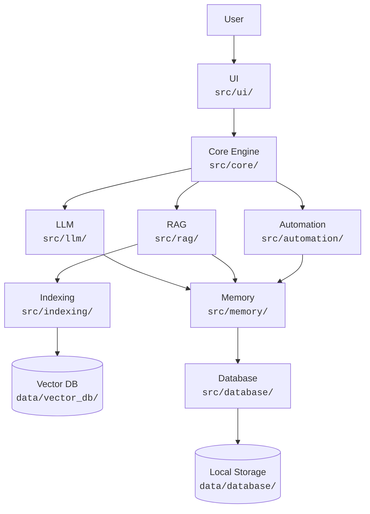
---

## 4. Repository Architecture

The project repository is organized into the following major directories:

```text
PrivAssist/
│
├── src/
│   ├── ui/
│   ├── core/
│   ├── llm/
│   ├── rag/
│   ├── indexing/
│   ├── automation/
│   ├── memory/
│   ├── database/
│   └── utils/
│
├── tests/
│
├── docs/
│
├── assets/
│
├── data/
│   ├── documents/
│   ├── vector_db/
│   └── database/
│
├── README.md
├── requirements.txt
└── .gitignore
```

---

# 5. Source Code Architecture

## 5.1 UI Layer — `src/ui/`

The UI layer provides the interface through which users interact with PrivAssist.

### Responsibilities

* Display the assistant interface.
* Accept text input.
* Display AI responses.
* Display conversation history.
* Provide document-management controls.
* Provide settings and configuration interfaces.
* Display automation confirmations when required.
* Provide optional voice interaction controls.

The UI should not directly contain AI inference, database logic, or system automation code. Instead, it communicates with the core application layer.

---

## 5.2 Core Layer — `src/core/`

The core layer acts as the central coordinator of PrivAssist.

It receives user requests and determines which components should process them.

### Responsibilities

* Request handling.
* Intent identification.
* Task routing.
* Context management.
* Communication between modules.
* Response orchestration.
* Error handling.
* Permission and confirmation checks.

For example:

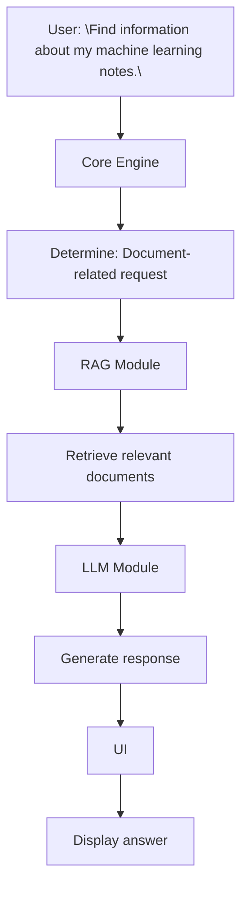

The core layer prevents individual modules from becoming tightly coupled.

---

## 5.3 LLM Layer — `src/llm/`

The LLM layer is responsible for interacting with the locally hosted Large Language Model.

### Responsibilities

* Load the local model.
* Manage model configuration.
* Generate responses.
* Process prompts.
* Handle context provided by the core and RAG systems.
* Manage model-specific inference settings.

The LLM layer should expose a consistent interface to the rest of the application.

For example:

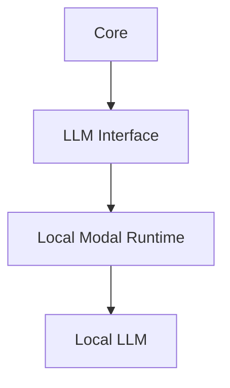
This abstraction allows the underlying model or inference engine to be replaced later without rewriting the entire application.

---

## 5.4 RAG Layer — `src/rag/`

The RAG layer provides contextual information from locally stored documents.

### Responsibilities

* Receive a user query.
* Convert the query into an appropriate retrieval representation.
* Search the vector database.
* Retrieve relevant document chunks.
* Rank or filter retrieved information.
* Provide contextual information to the LLM.

The basic workflow is:

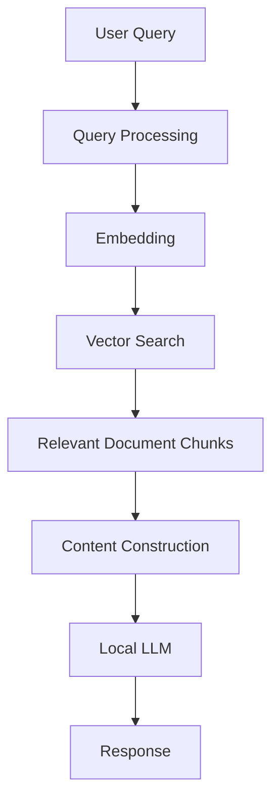
---

## 5.5 Indexing Layer — `src/indexing/`

The indexing layer prepares user documents for retrieval.

### Responsibilities

* Detect supported documents.
* Extract document text.
* Clean and normalize text.
* Split documents into chunks.
* Generate embeddings.
* Store embeddings and metadata.
* Update or remove document indexes.

The indexing process is:

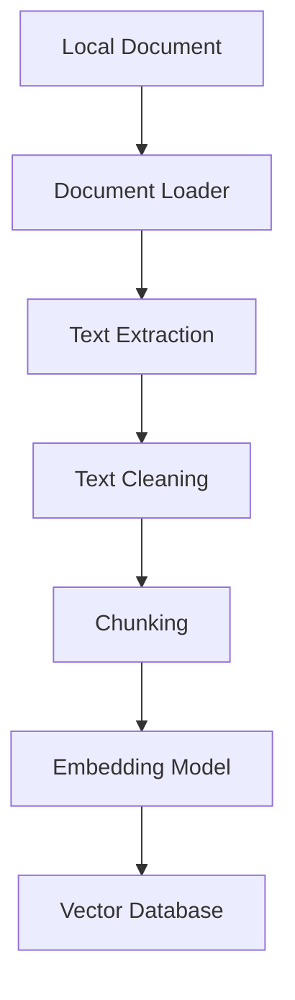

The indexing layer works primarily with:

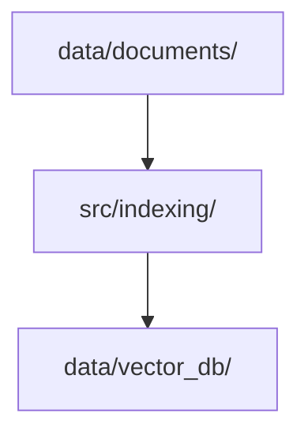

---

## 5.6 Automation Layer — `src/automation/`

The automation layer allows PrivAssist to perform selected operations on the user's desktop.

### Possible responsibilities

* Launch applications.
* Open files and folders.
* Perform selected keyboard or mouse operations.
* Retrieve system information.
* Execute predefined system actions.
* Interact with supported applications.

Automation operations should be restricted and validated.

The system should follow:

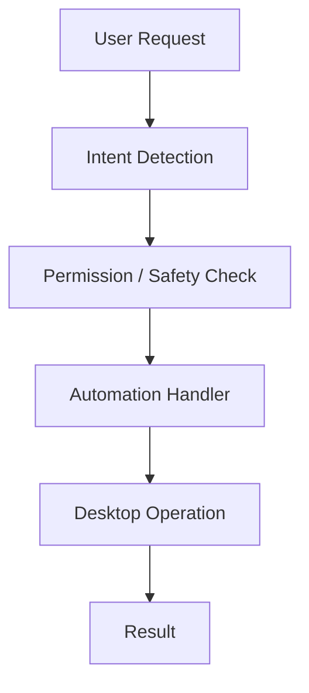

PrivAssist should **not provide unrestricted autonomous access to the operating system**.

Operations that could cause data loss, security issues, or other significant consequences should require explicit user confirmation where appropriate.

---

## 5.7 Memory Layer — `src/memory/`

The memory layer manages information required for maintaining useful context across interactions.

### Responsibilities

* Conversation history.
* Short-term context.
* Selected long-term information.
* Context retrieval.
* Memory updates.
* Memory deletion.

Memory data should remain locally stored.

The memory layer should also distinguish between:

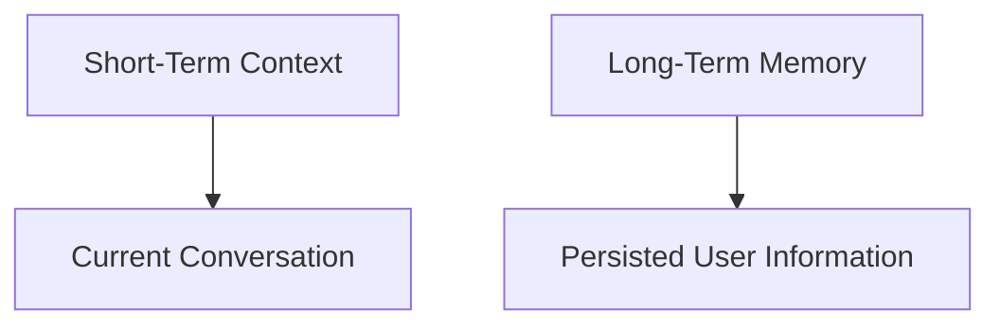

Only information necessary for useful personalization should be retained.

---

## 5.8 Database Layer — `src/database/`

The database layer provides structured local storage for application information.

### Possible data

* Conversations.
* Messages.
* User settings.
* Document metadata.
* Memory records.
* Automation history.
* Application configuration.

The database layer provides a controlled interface so that other modules do not directly manipulate database files.

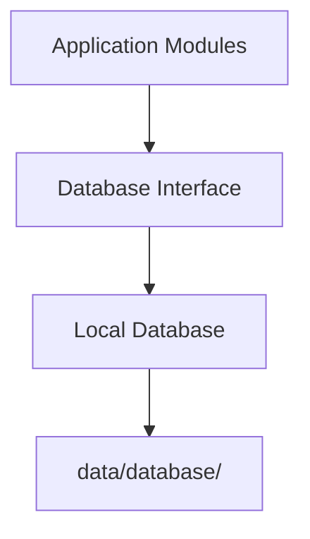

---

## 5.9 Utilities Layer — `src/utils/`

The utility layer contains reusable helper functionality.

### Possible responsibilities

* Logging.
* Configuration handling.
* File utilities.
* Validation.
* Error handling.
* Path management.
* Common helper functions.
* Application-wide constants.

Utilities should contain generic functionality rather than application-specific business logic.

---

# 6. Data Architecture

PrivAssist uses local storage for its primary application data.

<!-- ```text
data/
│
├── documents/
│   ├── PDF files
│   ├── DOCX files
│   ├── TXT files
│   └── Other supported documents
│
├── vector_db/
│   └── Document embeddings
│       and retrieval metadata
│
└── database/
    └── Application database
``` -->
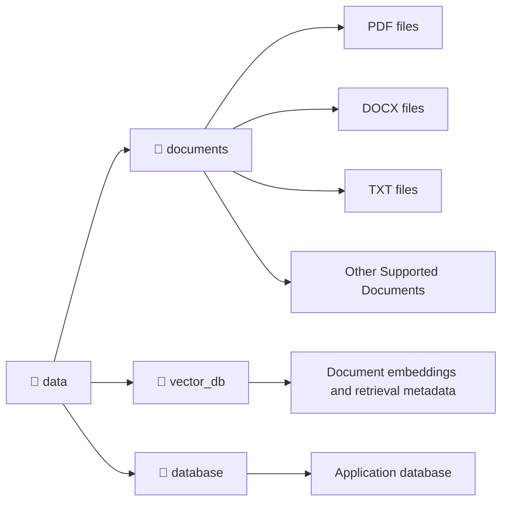

### `data/documents/`

Contains documents selected by the user for local processing.

### `data/vector_db/`

Contains vector representations and metadata generated from indexed documents.

### `data/database/`

Contains structured application data such as conversations, settings, and memory records.

---

# 7. Module Communication

PrivAssist follows a controlled communication pattern.

Modules should communicate through defined interfaces instead of directly accessing the internal implementation of other modules.

For example:

```text
UI
 │
 ▼
Core
 │
 ├──────────────► LLM
 │
 ├──────────────► RAG
 │                  │
 │                  ▼
 │               Indexing
 │                  │
 │                  ▼
 │              Vector DB
 │
 ├──────────────► Memory
 │                  │
 │                  ▼
 │               Database
 │
 └──────────────► Automation
```

This reduces coupling and allows individual components to be replaced or upgraded independently.

---

# 8. Privacy Architecture

Privacy is a primary architectural principle of PrivAssist.

The preferred data flow is:

```text
User
 │
 ▼
PrivAssist
 │
 ├── Local LLM
 ├── Local RAG
 ├── Local Vector Database
 ├── Local Memory
 └── Local Database
```

User documents and application data should not be transmitted to external AI services as part of normal operation.

If future versions introduce optional external services, such communication should be:

* Explicitly identified.
* Disabled by default where practical.
* Controlled through user settings.
* Limited to the minimum required data.
* Clearly separated from the offline processing pipeline.

---

# 9. Offline Architecture

The core AI pipeline is designed to operate locally:

```text
User Input
    │
    ▼
Local UI
    │
    ▼
Core Engine
    │
    ├──► Local LLM
    │
    ├──► Local RAG
    │
    ├──► Local Memory
    │
    └──► Local Automation
    │
    ▼
Local Response
```

Internet access should not be a fundamental dependency for core functionality.

External connectivity, if introduced later, should be treated as an optional capability rather than a mandatory requirement.

---

# 10. Security Considerations

Because PrivAssist can potentially interact with local files and system functions, security must be considered at the architectural level.

The system should implement:

* Input validation.
* Controlled automation commands.
* Explicit permission handling.
* Confirmation for sensitive operations.
* Restricted file access where appropriate.
* Safe command execution.
* Local database protection.
* Error handling.
* Activity logging where appropriate.
* Separation between AI-generated instructions and executable actions.

The LLM should not directly execute arbitrary commands.

Instead:

<!-- ```text
LLM Output
    │
    ▼
Command Validation
    │
    ▼
Permission Check
    │
    ▼
Approved Automation Action
    │
    ▼
Execution
``` -->
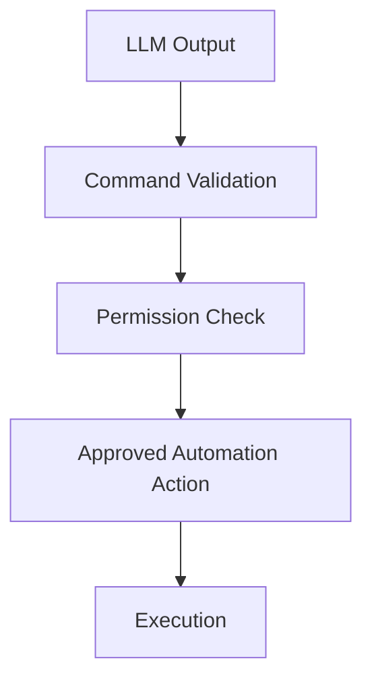

---

# 11. Scalability and Extensibility

The modular architecture allows PrivAssist to evolve without requiring a complete redesign.

Future components could include:

* Multiple local LLM providers.
* Additional embedding models.
* Multiple vector database implementations.
* Additional document formats.
* Advanced voice interaction.
* Plugin-based automation.
* Additional desktop integrations.
* Improved memory management.
* Optional cloud services.
* Multi-user support.
* Additional security controls.

For example, the LLM implementation can be changed while preserving the interface:

```text
                 ┌── Local LLM A
                 │
LLM Interface ───┼── Local LLM B
                 │
                 └── Future Model
```

The same principle applies to the RAG, database, and automation layers.

---

# 12. Testing Architecture

The `tests/` directory will contain tests for individual modules and integrated workflows.

The testing structure may follow:

```text
tests/
│
├── test_core/
├── test_llm/
├── test_rag/
├── test_indexing/
├── test_automation/
├── test_memory/
├── test_database/
└── test_utils/
```

Testing should cover:

* Individual module functionality.
* Data validation.
* Document processing.
* Retrieval accuracy.
* LLM integration.
* Database operations.
* Automation safety.
* Error handling.
* End-to-end assistant workflows.

---

# 13. Deployment Architecture

PrivAssist is intended primarily as a desktop application.

A typical deployment will contain:

```text
User Computer
│
├── PrivAssist Application
│
├── Local LLM Model
│
├── Embedding Model
│
├── Local Vector Database
│
├── Local Application Database
│
└── User Documents
```

The exact model and runtime requirements will depend on the final implementation and selected AI models.

---

# 14. Architectural Principles

The PrivAssist architecture follows these principles:

1. **Local-first processing**
2. **Privacy by design**
3. **Offline-first operation**
4. **Modular separation of responsibilities**
5. **Controlled automation**
6. **Minimal external dependencies**
7. **Clear interfaces between modules**
8. **Local data ownership**
9. **Testability**
10. **Future extensibility**

---

# 15. Summary

PrivAssist uses a modular architecture consisting of UI, core processing, LLM, RAG, indexing, automation, memory, database, and utility layers.

The **Core Engine** acts as the central coordinator, while specialized modules handle AI inference, document retrieval, memory, database operations, and desktop automation.

The architecture prioritizes local processing and data ownership while maintaining flexibility for future enhancements. This structure provides a foundation for developing a privacy-preserving offline AI desktop assistant that can be maintained and extended throughout the project's lifecycle.
