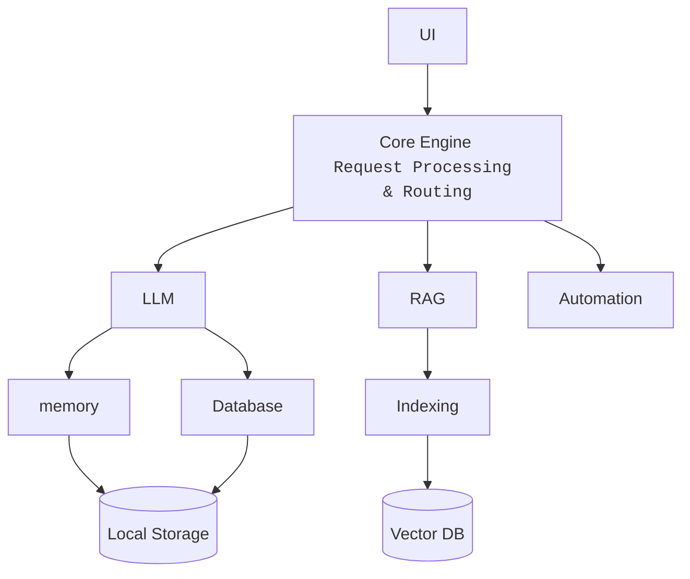
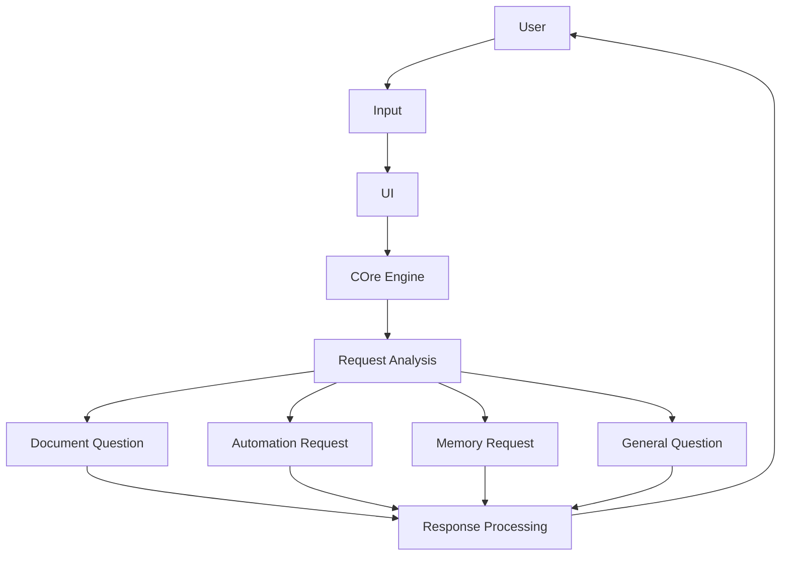
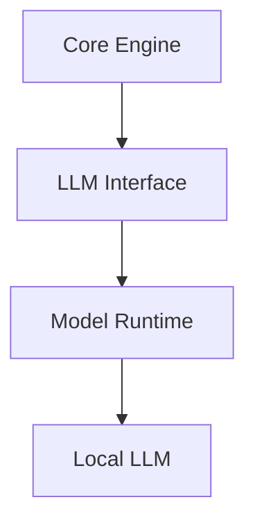
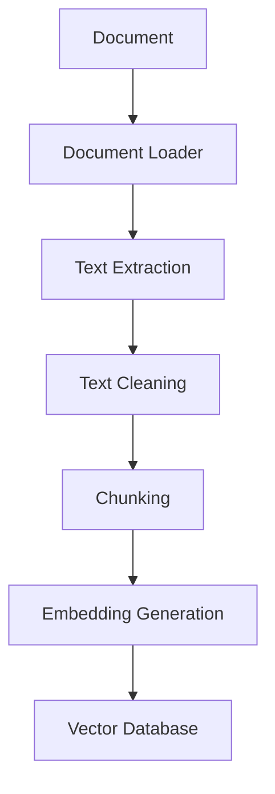
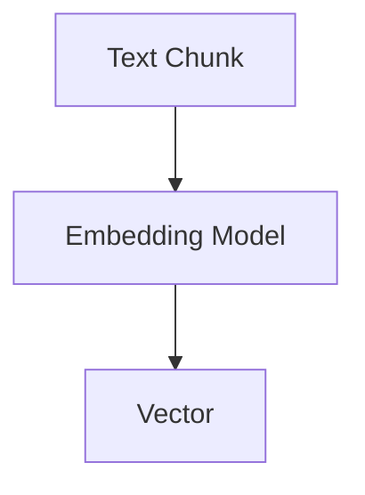
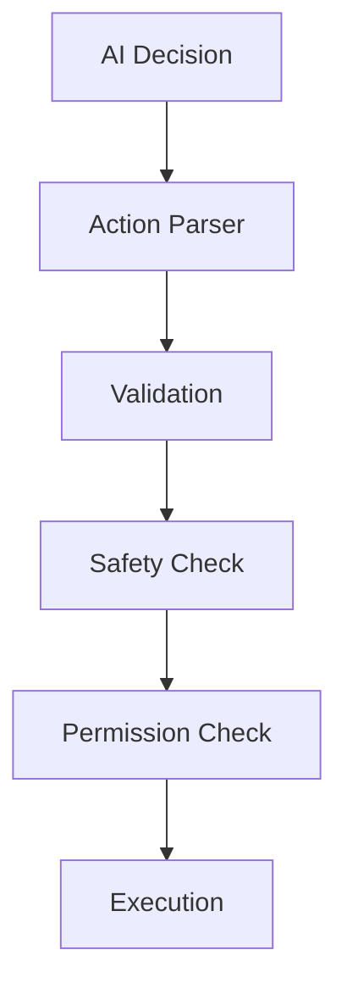
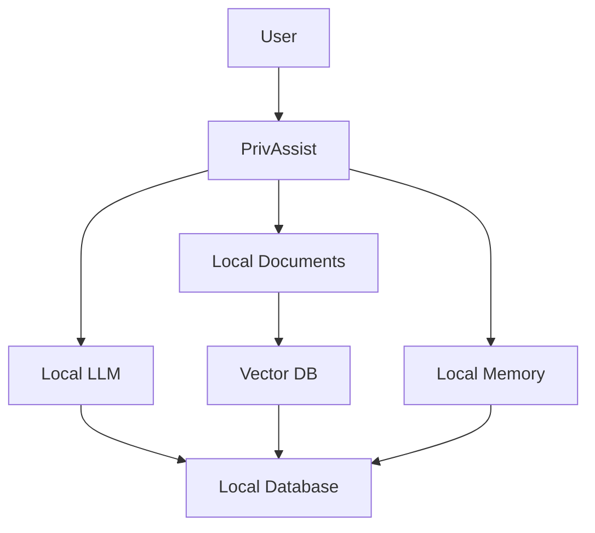
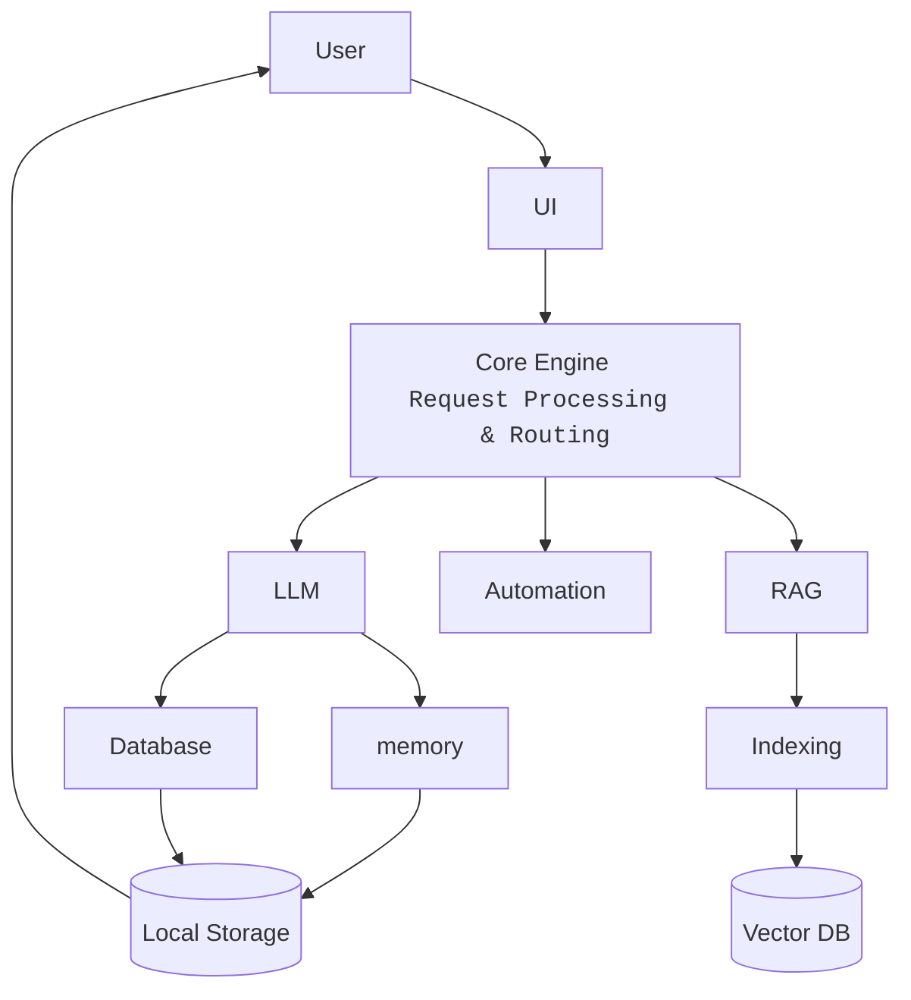

# PrivAssist: System Design

## 1. Overview

This document describes the detailed system design of **PrivAssist: A Privacy-Preserving Offline AI Desktop Assistant**.

The system is designed as a modular desktop application in which the major components work together to understand user requests, retrieve relevant local information, generate AI responses, maintain local context, and perform controlled desktop operations.

The primary design principles are:

* Local processing
* Privacy preservation
* Offline-first operation
* Modular components
* Controlled automation
* Local data storage
* Extensibility
* Testability

---

# 2. System Objectives

The system is designed to:

1. Accept natural-language requests from the user.
2. Understand and classify incoming requests.
3. Generate responses using a local Large Language Model.
4. Retrieve information from user-provided local documents.
5. Maintain conversation context and selected memory.
6. Perform predefined desktop operations.
7. Store application data locally.
8. Operate core functionality without continuous internet connectivity.
9. Provide controlled interaction between AI-generated instructions and system operations.

---

# 3. System Components

The major components of PrivAssist are:

<!-- ```text
┌─────────────────────────────────────────────┐
│                    UI                       │
│              User Interaction               │
└──────────────────────┬──────────────────────┘
                       │
                       ▼
┌─────────────────────────────────────────────┐
│                Core Engine                  │
│        Request Processing & Routing         │
└───────┬────────────┬────────────┬───────────┘
        │            │            │
        ▼            ▼            ▼
     ┌─────┐      ┌─────┐      ┌──────────┐
     │ LLM │      │ RAG │      │Automation│
     └──┬──┘      └──┬──┘      └──────────┘
        │            │
        │            ▼
        │        ┌─────────┐
        │        │Indexing │
        │        └────┬────┘
        │             │
        │             ▼
        │        ┌──────────┐
        │        │Vector DB │
        │        └──────────┘
        │
        └────────────┬─────────────┐
                     │             │
                     ▼             ▼
                  Memory       Database
                     │             │
                     └──────┬──────┘
                            ▼
                     Local Storage
``` -->


---

# 4. User Interaction Flow

The basic interaction flow begins when the user submits a request.

<!-- ```text
User
 │
 ▼
Input
 │
 ▼
UI
 │
 ▼
Core Engine
 │
 ▼
Request Analysis
 │
 ├── General Question ──────► LLM
 │
 ├── Document Question ─────► RAG ─────► LLM
 │
 ├── Automation Request ────► Automation
 │
 └── Memory Request ────────► Memory
 │
 ▼
Response Processing
 │
 ▼
UI
 │
 ▼
User
``` -->


The Core Engine determines which processing path is appropriate.

---

# 5. Request Processing Pipeline

The request-processing pipeline is one of the central workflows of PrivAssist.

## 5.1 Input

The user can provide a request through the user interface.

Example:

```text
"Explain the machine learning concepts in my notes."
```

The UI forwards the request to the Core Engine.

---

## 5.2 Request Analysis

The Core Engine analyzes the request to determine the appropriate operation.

Possible categories include:

```text
General Query
Document Query
Automation Request
Memory Operation
System Information Request
Conversation Request
```

---

## 5.3 Context Collection

Depending on the request, the system may collect additional context from:

* Current conversation
* Local memory
* Retrieved documents
* System information
* Application state

---

## 5.4 Processing

The Core Engine routes the request to the appropriate component.

For a general question:

```text
User Query
    ↓
Core
    ↓
LLM
    ↓
Response
```

For a document-based question:

```text
User Query
    ↓
Core
    ↓
RAG
    ↓
Relevant Documents
    ↓
Context
    ↓
LLM
    ↓
Response
```

For an automation request:

```text
User Request
    ↓
Core
    ↓
Intent Detection
    ↓
Safety Validation
    ↓
Permission / Confirmation
    ↓
Automation
    ↓
Operation Result
```

---

# 6. Local LLM System

The LLM subsystem provides natural-language understanding and response generation.

## 6.1 Components



The LLM interface provides an abstraction between the application and the underlying model runtime.

This allows the project to change the selected model or runtime later without changing the entire application.

---

# 7. RAG System Design

The RAG subsystem allows PrivAssist to answer questions using local documents.

## 7.1 Document Ingestion

The user provides supported documents to PrivAssist.



---

## 7.2 Document Chunking

Large documents are divided into smaller sections called chunks.

For example:

```text
Document
│
├── Chunk 1
├── Chunk 2
├── Chunk 3
├── Chunk 4
└── Chunk 5
```

Chunking allows the retrieval system to search for specific sections instead of processing an entire document for every request.

The exact chunk size and overlap will be determined during implementation and testing.

---

## 7.3 Embedding Generation

Each document chunk is converted into a numerical vector using an embedding model.

Conceptually:



These vectors represent the semantic meaning of the corresponding text.

---

## 7.4 Vector Storage

Generated embeddings and their associated metadata are stored in the local vector database.

```text
Vector
   │
   ├── Document ID
   ├── Chunk ID
   ├── Source
   └── Metadata
```

This information allows the system to identify where retrieved content originated.

---

# 8. RAG Query Flow

When the user asks a question about local documents:

```text
User Question
      │
      ▼
Query Processing
      │
      ▼
Query Embedding
      │
      ▼
Vector Search
      │
      ▼
Top Relevant Chunks
      │
      ▼
Context Construction
      │
      ▼
Local LLM
      │
      ▼
Generated Answer
```

The retrieved information is supplied to the LLM as contextual information.

The system should prioritize retrieved local information when answering document-specific questions.

---

# 9. Memory System Design

The memory subsystem provides local context management.

## 9.1 Short-Term Memory

Short-term memory represents the current conversation context.

Example:

```text
User:
"What is RAG?"

Assistant:
"RAG stands for Retrieval-Augmented Generation."

User:
"Why is it useful?"

```

The system can use the previous conversation to understand what "it" refers to.

---

## 9.2 Long-Term Memory

Long-term memory stores selected information that may be useful across future conversations.

Possible examples include:

* User preferences.
* Frequently used settings.
* Selected project information.
* Explicitly saved information.

Memory should not automatically store every piece of conversation data.

---

## 9.3 Memory Flow

```text
Conversation
     │
     ▼
Memory Manager
     │
     ├── Temporary Context
     │
     └── Persisted Memory
             │
             ▼
        Local Database
```

Users should be able to manage or remove persisted memory.

---

# 10. Desktop Automation System

The automation subsystem enables PrivAssist to perform controlled desktop operations.

## 10.1 Automation Flow

```text
User Request
     │
     ▼
Core Engine
     │
     ▼
Intent Detection
     │
     ▼
Action Identification
     │
     ▼
Validation
     │
     ▼
Permission / Confirmation
     │
     ▼
Automation Handler
     │
     ▼
Desktop Operation
     │
     ▼
Result
```

---

## 10.2 Example

User:

```text
"Open my Documents folder."
```

Processing:

```text
Natural Language Request
        ↓
Automation Intent
        ↓
Identify Target
        ↓
Validate Path
        ↓
Execute Approved Action
        ↓
Open Folder
        ↓
Return Result
```

---

## 10.3 Automation Safety

The LLM should not directly execute arbitrary operating-system commands.

Instead, AI-generated actions should pass through a controlled execution layer.



Potentially destructive operations should require explicit user confirmation.

---

# 11. Database System

The database subsystem stores structured application information.

Possible entities include:

```text
Users / Settings
      │
      ├── Conversations
      │       │
      │       └── Messages
      │
      ├── Memories
      │
      ├── Documents
      │
      └── Automation Logs
```

The exact schema will be defined separately in `Database_Design.md`.

The database layer should provide controlled access through application interfaces rather than allowing every module to directly manipulate the database.

---

# 12. Document Processing Flow

The complete document lifecycle is:

```text
User Document
     │
     ▼
Document Storage
     │
     ▼
Document Loader
     │
     ▼
Text Extraction
     │
     ▼
Text Cleaning
     │
     ▼
Chunking
     │
     ▼
Embedding Generation
     │
     ▼
Vector Database
     │
     ▼
Retrieval
     │
     ▼
LLM Context
```

If a document is removed, its associated indexed information should also be removed or invalidated.

---

# 13. Conversation Flow

A typical conversation follows:

```text
User
 │
 ▼
UI
 │
 ▼
Core Engine
 │
 ▼
Context Manager
 │
 ├── Conversation History
 │
 ├── Memory
 │
 └── RAG Context (if required)
 │
 ▼
LLM
 │
 ▼
Generated Response
 │
 ▼
Core Engine
 │
 ▼
Memory / Database
 │
 ▼
UI
 │
 ▼
User
```

This allows the assistant to produce context-aware responses while keeping the relevant information locally stored.

---

# 14. Error Handling

Each subsystem should handle errors without causing the entire application to terminate unexpectedly.

Examples include:

### LLM Errors

* Model unavailable.
* Insufficient memory.
* Model loading failure.
* Inference failure.

### RAG Errors

* Unsupported document.
* Text extraction failure.
* Embedding failure.
* Vector database failure.

### Automation Errors

* Application not found.
* Invalid file path.
* Permission denied.
* Unsupported operation.

### Database Errors

* Database unavailable.
* Invalid query.
* Data corruption.
* Storage failure.

Errors should be captured by the appropriate module and passed to the Core Engine for user-friendly reporting.

---

# 15. Configuration Management

Application configuration should be separated from application logic.

Possible configuration values include:

```text
LLM model path
Embedding model
Vector database location
Database location
Maximum context size
Retrieval count
Logging level
Automation settings
Voice settings
UI settings
```

Configuration should be loaded through a centralized configuration mechanism.

Sensitive credentials, if ever required by optional external services, should not be hard-coded into the source code.

---

# 16. Logging System

A local logging mechanism should be used to help diagnose application problems.

Possible log categories:

```text
INFO
WARNING
ERROR
DEBUG
```

Example:

```text
[INFO] Application started
[INFO] LLM loaded
[INFO] Document indexing started
[INFO] Document indexing completed
[WARNING] Document format unsupported
[ERROR] Vector database unavailable
```

Logs should avoid unnecessarily recording sensitive user content.

---

# 17. Security and Privacy Flow

The system follows a local-first data flow:



The architecture avoids sending normal user data to remote AI services.

---

# 18. Offline Operation

PrivAssist is designed so that its core workflow can operate without internet access.

The offline pipeline is:

```text
User
 │
 ▼
PrivAssist UI
 │
 ▼
Core Engine
 │
 ├──► Local LLM
 │
 ├──► Local RAG
 │
 ├──► Local Memory
 │
 ├──► Local Database
 │
 └──► Local Automation
 │
 ▼
Response
```

Internet access may be required during initial installation, dependency downloads, model downloads, or optional future integrations, but it should not be a mandatory requirement for normal core operation.

---

# 19. End-to-End System Flow

The complete system can be represented as:

<!-- ```text
                         USER
                           │
                           ▼
                    ┌─────────────┐
                    │     UI      │
                    └──────┬──────┘
                           │
                           ▼
                    ┌─────────────┐
                    │ Core Engine │
                    └──────┬──────┘
                           │
             ┌─────────────┼─────────────┐
             │             │             │
             ▼             ▼             ▼
          ┌─────┐       ┌─────┐    ┌────────────┐
          │ LLM │       │ RAG │    │ Automation │
          └──┬──┘       └──┬──┘    └────────────┘
             │             │
             │             ▼
             │        ┌──────────┐
             │        │ Indexing │
             │        └────┬─────┘
             │             │
             │             ▼
             │        ┌──────────┐
             │        │ Vector DB│
             │        └──────────┘
             │
             ├──────────────┐
             │              │
             ▼              ▼
          Memory         Database
             │              │
             └──────┬───────┘
                    │
                    ▼
              Local Storage
                    │
                    ▼
                  USER
``` -->

---

# 20. System Design Principles

The implementation should follow these principles:

1. **Separation of concerns**
   Each module should have a clearly defined responsibility.

2. **Local-first processing**
   User information should be processed locally whenever practical.

3. **Controlled execution**
   AI-generated actions must pass through validation before system execution.

4. **Loose coupling**
   Modules should communicate through defined interfaces.

5. **Data minimization**
   Only necessary information should be stored.

6. **Fail-safe behavior**
   Errors and uncertain automation requests should fail safely rather than executing potentially harmful actions.

7. **Replaceable components**
   Models, vector databases, and other implementation details should be replaceable without redesigning the entire system.

8. **Testability**
   Components should be independently testable before integration.

---

# 21. Summary

The PrivAssist system design defines how the individual architectural components work together to provide an offline AI desktop assistant.

The **Core Engine** coordinates user requests, while the LLM handles natural-language generation, RAG provides contextual information from local documents, the Memory subsystem maintains useful local context, the Database subsystem manages structured application data, and the Automation subsystem performs controlled desktop operations.

The complete system is designed around **privacy, local processing, controlled execution, modularity, and offline usability**. This design provides the technical foundation for implementing the project components defined in the Project Architecture.
